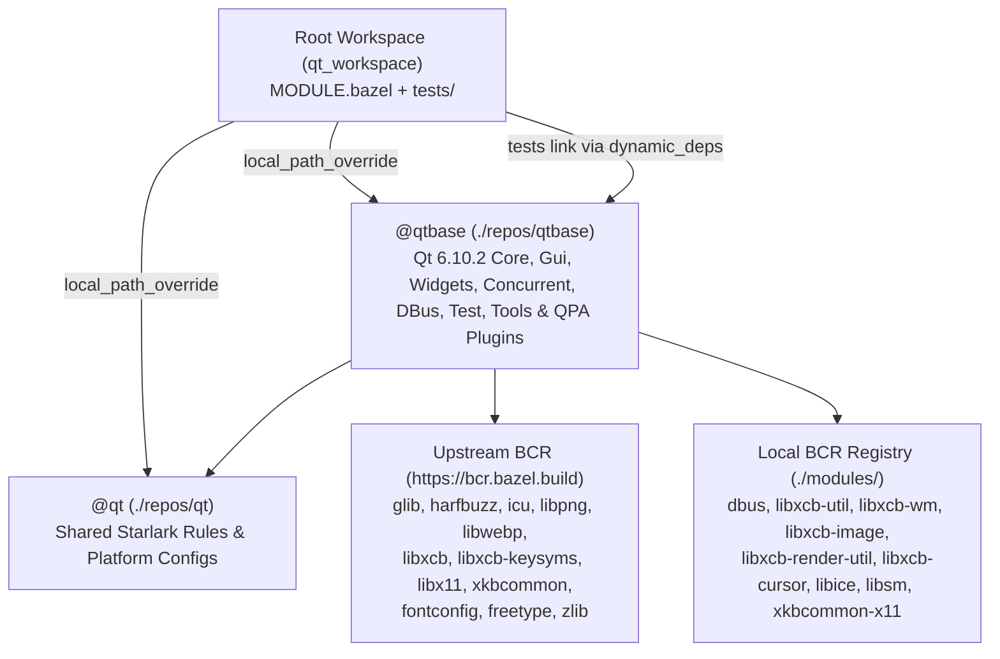

# Engineering Plan: Modular Qt 6.10.2 Bazel Build (`@qt` & `@qtbase`)

## 1. Architecture & Module Layout

We will organize the build into four clean layers—with **no `interface_libs` folder** and **zero modifications to tracked upstream Qt source files** in `repos/qtbase`:

1. **Local BCR Modules (`./modules/<name>/<version>/`)**:
   - Served via `.bazelrc` (`common --registry=file:///%workspace%/ --registry=https://bcr.bazel.build`) and `bazel_registry.json`.
   - Structured in standard BCR layout (`metadata.json`, `<version>/MODULE.bazel`, `<version>/source.json`, `<version>/overlay/BUILD.bazel`, etc.) with `rules_license` metadata so they can be upstreamed directly to the Bazel Central Registry.
2. **`@qt` (`./repos/qt`)**:
   - Shared Starlark rules, tool wrappers, and platform `config_setting` definitions reusable across all Qt 6.10.2 modules and downstream targets.
3. **`@qtbase` (`./repos/qtbase`)**:
   - Zero-patch Bazel overlay (`MODULE.bazel`, `BUILD.bazel`, `qtbase_config.bzl`) building host tools (`syncqt`, `moc`, `rcc`, `uic`), `cc_library` + `cc_shared_library` targets (`core`, `gui`, `widgets`, `concurrent`, `dbus`, `test`), and shared QPA plugins (`offscreen`, `xcb`, `cocoa`).
4. **Root Workspace (`MODULE.bazel`, `BUILD.bazel`, `tests/`)**:
   - Ties `@qt` and `@qtbase` together with `local_path_override`, configures the Clang toolchain and target platforms, and runs verification tests under `tests/`.

---

## 2. Dependency Strategy (Upstream BCR + Local BCR Modules in `./modules/`)

All third-party and Linux/Unix system libraries are consumed as proper Bazel modules—either from upstream BCR (`https://bcr.bazel.build`) or from our local BCR registry in `./modules/`:

| Dependency | Source | Module Name & Details |
| :--- | :--- | :--- |
| `glib`, `harfbuzz`, `icu`, `libpng`, `libwebp`, `zlib` | **Upstream BCR** | Unicode, text shaping, image codecs, and compression. |
| `fontconfig` (`2.16.0`) & `freetype` (`2.14.1.bcr.1`) | **Upstream BCR** | Font discovery and rendering (replaces bundled `src/3rdparty/freetype`). |
| `libxcb` (`1.17.0.bcr.3`), `libxcb-keysyms` (`0.4.1.bcr.1`), & `libx11` (`1.8.12.bcr.5`) | **Upstream BCR** | Core X11 (`Xlib.h`, `Xlib-xcb.h`, `src/x11_xcb.c`), XCB protocol extensions (`randr`, `xfixes`, `sync`, `xkb`, `shape`, `shm`, `render`, `xinput`), and `libxcb-keysyms` (`xcb/xcb_keysyms.h`). |
| `xkbcommon` (`1.9.2.bcr.beta.1`) | **Upstream BCR** | Core `libxkbcommon` keymap/state library. |
| `xkbcommon-x11` (`1.9.2`) | **Local BCR (`./modules/xkbcommon-x11`)** | Builds `xkbcommon-x11` (`src/x11/*.c`, `include/xkbcommon/xkbcommon-x11.h`) from upstream `libxkbcommon`, depending on `@xkbcommon` and `@libxcb`. |
| `dbus` (`1.16.2`) | **Local BCR (`./modules/dbus`)** | Builds `libdbus-1` (`:dbus` and `:dbus_shared`) from upstream freedesktop `dbus` release tarball. |
| `libxcb-util` (`0.4.1`) | **Local BCR (`./modules/libxcb-util`)** | Builds `libxcb-util` (`xcb_aux.h`, `xcb_event.h`, `xcb_atom.h`), depending on `@libxcb` and `@xorgproto`. |
| `libxcb-wm` (`0.4.2`) | **Local BCR (`./modules/libxcb-wm`)** | Builds `libxcb-icccm` (`xcb/xcb_icccm.h`) from `xcb-util-wm`, depending on `@libxcb` and `@xorgproto`. |
| `libxcb-image` (`0.4.1`) | **Local BCR (`./modules/libxcb-image`)** | Builds `libxcb-image` (`xcb/xcb_image.h`) from `xcb-util-image`, depending on `@libxcb`, `@libxcb-util`, and `@xorgproto`. |
| `libxcb-render-util` (`0.3.10`) | **Local BCR (`./modules/libxcb-render-util`)** | Builds `libxcb-renderutil` (`xcb/xcb_renderutil.h`) from `xcb-util-renderutil`, depending on `@libxcb` and `@xorgproto`. |
| `libxcb-cursor` (`0.1.5`) | **Local BCR (`./modules/libxcb-cursor`)** | Builds `libxcb-cursor` (`xcb/xcb_cursor.h`) from `xcb-util-cursor`; a hard requirement of the Qt 6.10 XCB plugin (`qxcbcursor.h`). Depends on `@libxcb`, `@libxcb-image`, and `@libxcb-render-util`. |
| `libice` (`1.1.2`) | **Local BCR (`./modules/libice`)** | Builds `libICE` (`X11/ICE/ICElib.h`) from upstream X.Org `libICE`, depending on `@xorgproto` and `@libxtrans`. |
| `libsm` (`1.2.5`) | **Local BCR (`./modules/libsm`)** | Builds `libSM` (`X11/SM/SMlib.h`) from upstream X.Org `libSM`, depending on `@libice`, `@xorgproto`, and `@libxtrans`. |

---

## 3. Detailed Component Design

### 3.1 Local BCR Registry Modules (`./modules/`)

Each module under `/usr/local/google/home/simmers/development/qt_workspace/modules/<module_name>/` follows the exact BCR specification:
- `metadata.json`
- `<version>/MODULE.bazel` (using latest `platforms = "1.1.0"`, `rules_cc = "0.2.26"`, `rules_license = "1.0.0"`)
- `<version>/source.json` (with upstream tarball URL, SHA-256 integrity hash, `strip_prefix`, and `overlay` integrity hashes)
- `<version>/overlay/BUILD.bazel` (exporting `rules_license` `license(...)` targets and `cc_shared_library` where appropriate)

### 3.2 `@qt` Module (`repos/qt/`)

- **`repos/qt/MODULE.bazel`**:
  - Declares `module(name = "qt", version = "6.10.2")` with dependencies on `platforms` (`1.1.0`), `rules_cc` (`0.2.26`), and `rules_license` (`1.0.0`).
- **`repos/qt/BUILD.bazel`**:
  - Declares `license` (`BSD-3-Clause`) and the 6 supported Clang target platform `config_setting`s (`:linux_x86_64`, `:linux_arm64`, `:osx_x86_64`, `:osx_arm64`, `:windows_x86_64`, `:windows_arm64`).
- **`repos/qt/qt_tools.bzl`**:
  - `qt_sync_headers`: Invokes `@qtbase//:syncqt` in `-all -copy` mode (plus generated config/export headers) to populate a Bazel tree artifact directory (`include/Qt<Module>`, `include/Qt<Module>/6.10.2/Qt<Module>/private`, `qpa`, `rhi`) and returns a `CcInfo` provider with the module's public and private include paths.
  - `moc_gen`: Invokes `@qtbase//:moc` on headers (`moc_<name>.cpp`) and `.moc`-including sources (`<name>.moc`).
  - `qt_export_header`: Generates `qt<module>exports.h` from `cmake/modulecppexports.h.in` and `Qt<Module>Depends`.
  - `qt_generate_qrc`: Generates `.qrc` XML files (`qpdf.qrc`, `gui_shaders.qrc`, `qstyle.qrc`, `qstyle1.qrc`, `qstyle_fusion.qrc`, `qmessagebox.qrc`) at build time without checking in generated `.qrc` files.
- **`repos/qt/qt_internal_library.bzl`**:
  - `qt_internal_library`:
    - Runs `moc_gen` on `moc_hdrs` and `moc_srcs`.
    - Declares the `cc_library` target (`<name>`) with `QT_BUILD_<MODULE>_LIB` in `local_defines` (so symbols are `dllexport` / default visibility when building the library and `dllimport` when consumed).
    - Declares the LGPL-compliant `cc_shared_library` target (`<name>_shared`) with `roots = [":<name>"]` and `dynamic_deps` wired to dependent Qt `cc_shared_library` targets.
  - `qt_static_plugin`:
    - Builds QPA platform plugins (`offscreen`, `xcb`, `cocoa`) as **statically linked** plugins: the implementation is compiled with `QT_STATICPLUGIN` and a generated `Q_IMPORT_PLUGIN(<Class>)` translation unit is linked `alwayslink`. Runtime-loadable `.so` plugins under a `platforms/` directory are deferred to a later phase (see PHASE2.md §6.6).
- **`repos/qt/qt.bzl`** (Public API for downstream users & tests):
  - `qt_resource` & `qt_resource_via_qrc`: Runs `@qtbase//:rcc` to embed resources.
  - `qt_ui_library`: Runs `@qtbase//:uic` to generate `ui_<name>.h`.
  - `qt_cc_library`: Runs `moc_gen` on headers with `Q_OBJECT` and wraps `cc_library`.
  - `qt_cc_binary` & `qt_cc_test`:
    - Runs `moc_gen` on headers/sources as needed.
    - Inspects `deps` (`@qtbase//:core`, `@qtbase//:gui`, `@qtbase//:widgets`, `@qtbase//:concurrent`, `@qtbase//:dbus`, `@qtbase//:test`) and automatically populates `dynamic_deps` with the corresponding `@qtbase//:<module>_shared` targets (plus transitive Qt shared deps, e.g., `widgets` -> `gui_shared`, `core_shared`).
    - Automatically links the `@qtbase//:offscreen` QPA plugin into GUI binaries/tests and sets `QT_QPA_PLATFORM=offscreen` in the `qt_cc_test` environment.

---

### 3.3 `@qtbase` Module (`repos/qtbase/`)

- **`repos/qtbase/MODULE.bazel`**:
  - Declares `module(name = "qtbase", version = "6.10.2")` and its `bazel_dep`s (`qt`, `platforms`, `rules_cc`, `rules_license`, `glib`, `harfbuzz`, `icu`, `libpng`, `libwebp`, `libxcb`, `libxcb-keysyms`, `libx11`, `xkbcommon`, `xkbcommon-x11`, `libxcb-util`, `libxcb-wm`, `libxcb-image`, `libxcb-render-util`, `libice`, `libsm`, `dbus`, `fontconfig`, `freetype`, `zlib`).
- **`repos/qtbase/qtbase_config.bzl`**:
  - Generates Qt 6.10.2 configuration headers at build time via Starlark actions (`qconfig.h`, `qconfig_p.h`, `qconfig.cpp`, `qtdeprecationdefinitions.h`, `qtcore-config.h`, `qtcore-config_p.h`, `qtgui-config.h`, `qtgui-config_p.h`, `qtwidgets-config.h`, `qtwidgets-config_p.h`, `qttestlib-config.h`, `qttestlib-config_p.h`, tracepoint headers, and `.rcc/qmimeprovider_database.cpp` from `src/corelib/mimetypes/3rdparty/tika-mimetypes.xml`).
  - Incorporates all Qt 6.10.2 feature flags (`QT_FEATURE_cxx2c -1`, `QT_FEATURE_android_16kb_pages -1`, `QT_FEATURE_copy_file_range`, `QT_FEATURE_dup3`, `QT_FEATURE_accept4`, `QT_FEATURE_emojisegmenter`, `QT_FEATURE_directwritecolrv1 -1`, etc.).
- **`repos/qtbase/BUILD.bazel`**:
  - Exports `LGPL-3.0-only` license via `rules_license`.
  - **Host Tools**:
    - `:syncqt` (`src/tools/syncqt/main.cpp`)
    - `:bootstrap` (internal static bootstrap library for host tools, updated for 6.10.2 with `src/corelib/global/qalloc.cpp`)
    - `:moc`, `:rcc`, `:uic`
  - **Core Libraries (`cc_library` + `cc_shared_library`)**:
    - `:core` & `:core_shared` (updated for 6.10.2: `qalloc.cpp`, `qmetaassociation.cpp`, `qmetasequence.cpp`, `qrangemodel.cpp`)
    - `:concurrent` & `:concurrent_shared` (`dynamic_deps = [":core_shared"]`)
    - `:dbus` & `:dbus_shared` (`dynamic_deps = [":core_shared"]`)
    - `:gui` & `:gui_shared` (`dynamic_deps = [":core_shared", ":dbus_shared"]`; updated for 6.10.2: `qaccessibilityhints.cpp/.h`, `qaccessiblehelper.cpp`, and split Unix themes `qgenericunixtheme.cpp`, `qgnometheme.cpp`, `qkdetheme.cpp`, `qdbuslistener.cpp`, `qdbussettings.cpp`, `qgnomeportalinterface.cpp`)
    - `:widgets` & `:widgets_shared` (`dynamic_deps = [":core_shared", ":gui_shared"]`; updated for 6.10.2: `qtooltip_p.h` in `moc_hdrs`, `qsystemtrayicon_qpa.cpp` on non-X11, updated `qstyle.qrc` & `qstyle_fusion.qrc` image lists)
    - `:test` & `:test_shared` (`dynamic_deps = [":core_shared"]`; updated for 6.10.2: `qtestcrashhandler_unix.cpp` / `qtestcrashhandler_win.cpp`)
  - **QPA Platform Plugins**:
    - `:offscreen` (static)
    - `:xcb_qpa` & `:xcb_qpa_shared` + `:xcb` (static plugin, Linux)
    - `:cocoa` / `:qcocoa_plugin` (macOS)

---

### 3.4 Root Workspace & Verification Tests

- **`BUILD.bazel`**:
  - Intentionally empty; platforms come from `@llvm//platforms` (e.g. `@llvm//platforms:linux_amd64_gnu.2.39`, selected in `.bazelrc`).
- **`MODULE.bazel`**:
  - Adds `bazel_dep`s for `qt`, `qtbase`, and BCR dependencies, plus `local_path_override` pointing `qt` -> `./repos/qt` and `qtbase` -> `./repos/qtbase`.
- **`tests/`**:
  - `tests/hello_world`: Console and GUI (`QApplication` + `QPushButton`) binaries/tests using `@qtbase//:core`, `@qtbase//:gui`, `@qtbase//:widgets`.
  - `tests/moc_test`: Tests `Q_OBJECT` signal/slot generation in headers and `.cpp` files via `qt_cc_test`.
  - `tests/regex`: Tests `QRegularExpression` matching.
  - `tests/uic_demo`: Tests `qt_ui_library`, `qt_resource`, and `qt_resource_via_qrc`.
  - `tests/qtest_sample`: A `QtTest` (`@qtbase//:test`) unit test verifying `QTest::qExec` and `QSignalSpy`.

---

## 4. Verification Criteria

1. All 8 missing Linux/X11/DBus libraries (`dbus`, `libxcb-util`, `libxcb-wm`, `libxcb-image`, `libxcb-render-util`, `libice`, `libsm`, `xkbcommon-x11`) build cleanly from source as BCR modules in `./modules/`.
2. `git status` in `repos/qtbase` shows zero modified tracked files (only `MODULE.bazel`, `BUILD.bazel`, and `qtbase_config.bzl`).
3. `bazel build @qtbase//...` builds all `@qtbase` libraries (`core_shared`, `gui_shared`, `widgets_shared`, `concurrent_shared`, `dbus_shared`, `test_shared`), tools (`syncqt`, `moc`, `rcc`, `uic`), and plugins (`offscreen`, `xcb`).
4. `bazel test //tests/...` builds and passes all tests linking dynamically against `@qtbase`'s `cc_shared_library` targets.
