# PHASE 2: Remaining Qt 6.10.2 Modules

> **Status:** Decisions recorded (see §6); ready to execute milestone M1. Builds on the conventions established in
> [PHASE1.md](PHASE1.md) (`@qt` rules module, `@qtbase`, upstream BCR first, local BCR
> modules under `./modules/`, `rules_license` everywhere, `cc_shared_library` for LGPL).
>
> **Scope baseline:** the Qt **6.8.3** module set from
> `reference/qt6_from_binary/extension/qt_modules.bzl` (lines 155–294), re-targeted at
> **6.10.2**. All repos are already checked out under `repos/` at `QT_REPO_MODULE_VERSION 6.10.2`.

---

## 1. Goals & Non-Goals

**Goals**

1. Provide each Qt 6.10.2 add-on repo as its own Bazel module (`@qtsvg`, `@qtdeclarative`, …),
   mirroring the `@qtbase` pattern: `cc_library` + `cc_shared_library` per Qt library, host
   tools as `cc_binary`, plugins via `qt_static_plugin`, zero patches to upstream sources.
2. Extend `@qt` with the extra generator rules Phase 2 needs (`qsb`, `qmltyperegistrar`,
   `qmlcachegen`, `qtwaylandscanner`, `qtprotobufgen`/`qtgrpcgen`, `repc`, `qscxmlc`, `lrelease`).
3. Prefer upstream BCR for every external dependency — **including** libraries Qt vendors
   (libtiff, libwebp, assimp, eigen). Only if a BCR module cannot be made to compile do we
   vendor a patched clone under `./modules/`, and then with the intent of upstreaming the
   fix to BCR.
4. Keep the Linux/X11 + Wayland desktop as the supported target for this phase.

**Non-Goals**

- `qtwebengine` (Chromium) and anything that only works with it on Linux (`qtwebview`'s Linux
  backend). `qtwebview` is built but has no functional Linux backend.
- `qtquickeffectmaker` — a GUI application (`qqem`), not a library; excluded.
- Windows/macOS-only repos (`qtactiveqt`) and IoT/automotive repos not in the 6.8.3 set
  (`qtcoap`, `qtmqtt`, `qtopcua`, `qtapplicationmanager`, `qtinterfaceframework`).
- Optional hardware/system backends with no BCR module (ALSA, PulseAudio, GStreamer,
  PipeWire, VAAPI, BlueZ, hunspell, speech-dispatcher/flite). These are tracked in §6 as
  follow-ups, gated behind `QT_FEATURE_*` flags set to `-1`. In particular `qtmultimedia`
  ships with the FFmpeg backend but **no audio device backend** in this phase.
- Runtime-loadable (`.so`) QML / QPA plugin layouts. Phase 2 links plugins statically via
  `Q_IMPORT_PLUGIN` (as Phase 1 does); the `qml/<Module>/` and `plugins/<type>/` on-disk
  layouts are a follow-up milestone.

---

## 2. 6.8.3 → 6.10.2 Module-Set Deltas

| 6.8.3 entry | 6.10.2 reality | Plan |
| :--- | :--- | :--- |
| `qtwaylandcompositor` | Binary-distro name for the **`qtwayland`** repo (client + compositor + `qtwaylandscanner`). Protocol XMLs now live in **`qtbase/src/3rdparty/wayland`**. | Build `@qtwayland`; expose the XMLs from `@qtbase` as a `filegroup`. No `wayland-protocols` dependency needed. |
| `qtdatavis3d` | Deprecated since 6.8 in favour of `qtgraphs`. | Build as a low-priority module (API-compat only); document deprecation. |
| `qtgraphs` | Now Graphs2D + Graphs3D; hard dep on `qtquick3d`. | Build after `qtquick3d`. |
| `qtquickeffectmaker` | Standalone GUI application (`qqem`), not a library. | **Excluded** from Phase 2. |
| `qtspeech` | Now **requires** `qtmultimedia`. | Build after `qtmultimedia`; `mock` backend only (no flite/speechd). |
| `qtwebview` | No Linux backend without `qtwebengine`. | Build the library; no plugin on Linux. |
| `qtmultimedia` | FFmpeg **7.1.2** reference; new vendored `signalsmith-stretch`, `tlsf`, `dr_libs`. | FFmpeg backend only (see §4). |
| `qtquick3d` | OpenXR SDK 1.1.49 vendored (`QtQuick3D.Xr`); assimp 6.0.2; meshoptimizer 0.23. | Keep vendored copies (Qt patches them). |
| `qtshadertools` | glslang 15.1.0 + SPIRV-Cross; **neither is in BCR**. | Build Qt's vendored, patched copies inside `@qtshadertools`. |
| `qtdeclarative` | New tools `qmlaotstats`, `svgtoqml`, lib `quickvectorimage`; **Python required** at build time. | Use `rules_python` toolchain for the generator scripts. |
| `qtgrpc` | Fully supported since 6.8. **Runtime does not link libgrpc** (own HTTP/2 channel over QtNetwork). | Only host tools need `@protobuf` (`libprotoc`, `protoc`). |
| `qtlocation` | `mapboxgl` plugin directory is orphaned (not referenced by CMake). | Skip it; build `itemsoverlay`/`osm`/`esri`/`mapbox`/`nokia` plugins. |
| `qtvirtualkeyboard` | `hunspell` git submodule is **empty** in the checkout. | Build without hunspell (`QT_FEATURE_hunspell -1`). |
| `qtimageformats` | libtiff 4.7.1 / libwebp 1.6.0 vendored. | Use BCR `libtiff` + `libwebp` instead of vendored copies. |
| `qtquick3d` / `qt3d` / `qtmultimedia` | assimp 6.0.2 and eigen 3.4.0 vendored. | Use BCR `assimp` 6.0.5 / `eigen` 3.4.0.bcr.3; fall back to a local patched module only if they fail to compile against Qt. |
| `qttools` / `qttranslations` | Not in the 6.8.3 binary list. | **Added** to scope (M7) for `lupdate`/`lrelease`/`qdoc`. |

---

## 3. Dependency Graph & Build Order

```mermaid
graph TD
    qtbase --> qtsvg
    qtbase --> qtimageformats
    qtbase --> qtshadertools
    qtbase --> qtlanguageserver
    qtbase --> qtserialport
    qtbase --> qtnetworkauth
    qtbase --> qthttpserver
    qtbase --> qtremoteobjects
    qtbase --> qtscxml
    qtbase --> qtwebsockets
    qtbase --> qtwebchannel
    qtbase --> qtsensors
    qtbase --> qtserialbus
    qtbase --> qtconnectivity
    qtbase --> qtpositioning
    qtbase --> qt5compat
    qtbase --> qt3d
    qtbase --> qtwayland
    qtbase --> qtcharts
    qtbase --> qtdatavis3d
    qtbase --> qtgrpc
    qtbase --> qttools
    qtbase --> qtdeclarative
    qtshadertools -.->|qsb| qtdeclarative
    qtdeclarative --> qtquicktimeline
    qtdeclarative --> qtlottie
    qtdeclarative --> qtlocation
    qtpositioning --> qtlocation
    qtdeclarative --> qtwebview
    qtdeclarative --> qtvirtualkeyboard
    qtsvg --> qtvirtualkeyboard
    qtdeclarative --> qtquick3d
    qtshadertools --> qtquick3d
    qtquick3d --> qtquick3dphysics
    qtquick3d --> qtgraphs
    qtshadertools --> qtmultimedia
    qtmultimedia --> qtspeech
    qtdeclarative --> qtquickeffectmaker
    qttools --> qttranslations
```



Solid edges are required deps (from each repo's `dependencies.yaml`); the dotted edge is a
host-tool dependency. Nearly every module also has an *optional* dep on `qtdeclarative`
for its QML plugin; those are enabled whenever `@qtdeclarative` is present.

**Milestones (in order):**

| # | Milestone | Modules | Unblocks |
| :-- | :--- | :--- | :--- |
| M1 | Leaf libraries | `qtsvg`, `qtimageformats`, `qtlanguageserver`, `qtshadertools` (+ **`qsb`**) | QML shaders, image plugins |
| M2 | QML core | `qtdeclarative` (+ **`qmltyperegistrar`, `qmlcachegen`, `qmlimportscanner`, `qmltc`, `qmllint`**) | Every QML module |
| M3 | Networking & plumbing (no new externals) | `qtwebsockets`, `qtwebchannel`, `qthttpserver`, `qtnetworkauth`, `qtremoteobjects` (+**`repc`**), `qtscxml` (+**`qscxmlc`**), `qt5compat`, `qtserialport`, `qtserialbus`, `qtsensors`, `qtpositioning`, `qtlocation`, `qtconnectivity`, `qtcharts`, `qtlottie`, `qtquicktimeline`, `qtvirtualkeyboard` | — |
| M4 | 3D stack | `qtquick3d` (+ `balsam`, `shadergen`), `qtquick3dphysics`, `qtgraphs`, `qtdatavis3d`, `qt3d` | — |
| M5 | Multimedia | `qtmultimedia` (FFmpeg backend), `qtspeech` (mock backend) | — |
| M6 | Wayland | `qtwayland` (+ **`qtwaylandscanner`**, client + compositor + `wayland-egl`/`wayland-shm` plugins) | Wayland QPA for tests |
| M7 | Tooling & i18n | `qttools` (`lupdate` incl. clang backend, `lrelease`, `lconvert`, `qdoc`, `uitools`, `designer`), `qttranslations`, `qtgrpc` (+ **`qtprotobufgen`, `qtgrpcgen`**), `qtwebview` | — |

Each milestone is one PR-sized change.

Each milestone ends with a `tests/<module>_*` smoke test and a green `bazel test //tests/...`.

### 3.1 Status

| Milestone | Status | Notes |
| :-- | :--- | :--- |
| M1 | ✅ Done | `@qtsvg` (`svg`, `svgwidgets`, `qsvg`/`qsvgicon` plugins), `@qtimageformats` (tga/wbmp/icns + BCR `libtiff`/`libwebp` for tiff/webp), `@qtlanguageserver` (internal static `jsonrpc`/`languageserver`), `@qtshadertools` (vendored glslang + SPIRV-Cross, `shadertools_shared`, **`qsb`**). Tests: `svg_render`, `imageformats`, `shadertools`. None of these repos has a `configure.cmake` with features, so no `*_config.bzl` was needed. |
| M2 | ✅ Done | **qtbase prerequisites landed:** `:xml`, `:sql` (+ static `qsqlite` driver on bundled SQLite amalgamation), `:network` (OpenSSL 3.5.8 linked, `QT_FEATURE_openssl_linked 1`, bundled libpsl DAFSA) + static `qopensslbackend` TLS plugin, `qlalr` host tool; test `netsqlxml`. **`@qtdeclarative` landed:** `qmlintegration`, `qmltoolingsettings`, `qmltyperegistrar` (lib + host tool), `qml` (with V4/masm x86_64 JIT + `rules_python` `udis86`/`RegExpJitTables` generators), `qmlmodels`, `qmlworkerscript`, `qmlmeta`, `qmlcompiler` + `qmlcachegen` (host tool), `quick` (with 140+ `qsb` + multiview shaders), `quickwindow`, `quicklayouts` (with vendored Yoga), `quickshapes`, `quicktemplates2`, `quickcontrols2impl`, `quickcontrols2`, `quickcontrols2basicstyleimpl`, `quickcontrols2basic`, `quickwidgets`, `quicktest`, plus static QML plugins (`qmlplugin`, `modelsplugin`, `workerscriptplugin`, `qmlmetaplugin`, `qtquick2plugin`, `quickwindow`, `qquicklayoutsplugin`, `qmlshapesplugin`, `qtquicktemplates2plugin`, `qtquickcontrols2implplugin`, `qtquickcontrols2plugin`, `qtquickcontrols2basicstyleimplplugin`, `qtquickcontrols2basicstyleplugin`, `quicktestplugin`) and `@qt` rules (`qt_lalr`, `qt_qml_type_registration`, `qt_qmldir`, `qt_qml_plugin_gen`, `qt_qsb`, `qt_qml_cachegen`). Test: `declarative_quick`. |
| M3 | ✅ Done | All 17 modules build and are exercised by `//tests/m3_smoke` (headless: `websockets` echo, `httpserver` round-trip, `serialbus` `virtualcan` plugin, `sensors` dummy backend, `positioning`, `statemachine`, `scxml` dynamic load, `remoteobjects` host, `core5compat` codecs; offscreen QML/GUI: `charts` widget render + QML imports for `QtCharts`/`QtPositioning`/`QtLocation` (itemsoverlay)/`Qt.labs.lottieqt`/`QtQuick.Timeline`/`QtQml.StateMachine`/`QtWebChannel`). Host tools: `repc` (`qlalr` on `parser.g`, run **without** `--no-debug` like upstream), `qscxmlc`, `canbusutil`, `qdbusxml2cpp` (`@qtbase`). `@qtbase` also gained `:wayland_protocols` for M6. |
| M4 | ✅ Done | **`@qtbase` OpenGL + `local_defines` cleanup:** enabled `QT_FEATURE_opengl 1` in `@qtbase`, added `:opengl` and `:openglwidgets` with hermetic `dlopen` GL 1.x stubs (`gen_qopengl_gl1_stubs_cpp`), and moved Qt-internal build macros (`QT_USE_QSTRINGBUILDER`, `QT_NO_FOREACH`, etc.) from public `defines` to `local_defines`. **All 5 3D modules landed:** `@qtquick3d` (`glslparser`, `utils`, `assetimport`, `runtimerender` with 95+ `qsb` + multiview shaders, `quick3d`, `assetutils`, `quick3dparticles`, `quick3dhelpers`, `quick3dhelpersimpl`, `iblbaker`, `assimpimporterplugin` using BCR `assimp` 6.0.5, plus host tools `balsam`, `balsamui`, `shadergen`, `meshdebug`, `instancer`, `shapegen`, `materialeditor`, `lightmapviewer`), `@qtquick3dphysics` (vendored PhysX 5 + `quick3dphysics`, `quick3dphysicshelpers`, `cooker` tool), `@qtgraphs` (`graphs` 2D/3D + `graphswidgets`), `@qtdatavis3d` (`datavisualization` + `datavisualizationqml`), and `@qt3d` (`3dcore`, `3drender` with `rhi`/`opengl` renderers, `3dinput`, `3dlogic`, `3dextras`, `3danimation`, `3dquick*`, `scene2d`/`scene3d`/`assimp` plugins) with `-publicNamespaceFilter "^::Qt3D.*"` in `qt_sync_headers`. Tests: `m4_3d_smoke_test`, `m4_datavis3d_smoke_test`. |
| M5 | ✅ Done | **`@qtmultimedia`:** `multimedia` (with x86_64 SSSE3/AVX2 SIMD helpers), `multimediawidgets`, `multimediaquick` (`QtMultimedia` QML module + `quickmultimedia` plugin), `spatialaudio` (using BCR `eigen` 3.4.0.bcr.3 + vendored `pffft` and `resonance_audio` with per-library `license()` targets), `spatialaudioquick3d` (`QtQuick3D.SpatialAudio` QML module), and `qffmpegmediaplugin` (FFmpeg 7.1.1 backend using BCR `ffmpeg@7.1.1.bcr.beta.13` with a 1-line `sysctl` patch for glibc >= 2.32, plus `@qtmultimedia//:ffmpeg_shared`). **`@qtspeech`:** `tts`, `ttsqml` (`QtTextToSpeech` QML module + `qmltts` plugin), and `qtexttospeech_mock` plugin. Test: `m5_smoke_test`. |
| M6 | ✅ Done | **`@qtbase` Wayland client & scanner:** `:qtwaylandscanner` host tool, `:wayland_global_private`, `:wayland_client` (`:wayland_client_shared` exporting `@wayland//:wayland_client`, `:wayland_cursor`, and `@@libffi+//:libffi`), `:wl_shell_integration_private`, `:qwayland` QPA plugin, `:qwayland_bradient_decoration_plugin`, `:qwayland_xdg_shell_integration_plugin`, `:qwayland_wl_shell_integration_plugin`, `:qwayland_fullscreen_shell_v1_plugin`, `:qwayland_egl_client_buffer_plugin`, `:qwayland_shm_emulation_server_buffer_plugin`, `:qwayland_drm_egl_server_buffer_plugin`. **`@qtwayland`:** `:wayland_client_features_private`, `:wayland_compositor` (`QtWayland.Compositor` QML module + `:qwaylandcompositorplugin`), `:wayland_egl_compositor_hw_integration_private`, QML compositor extensions (`:wayland_compositor_iviapplication`, `:wayland_compositor_presentationtime`, `:wayland_compositor_qtshell`, `:wayland_compositor_wlshell`, `:wayland_compositor_xdgshell` + static QML plugins), client plugins (`:qwayland_adwaita_decoration_plugin`, `:qwayland_ivi_shell_integration_plugin`, `:qwayland_qt_shell_integration_plugin`), and compositor buffer plugins (`:qwayland_egl_compositor_buffer_plugin`, `:qwayland_shm_emulation_compositor_buffer_plugin`, `:qwayland_drm_egl_compositor_buffer_plugin`, `:qwayland_eglstream_compositor_buffer_plugin`). `@qt` gained `qt_wayland.bzl` (`qt_wayland_client_protocol`, `qt_wayland_server_protocol` with `CcSharedLibraryHintInfo`). Tests: `m6_smoke_test`, `m6_client_plugins_smoke_test`. |
| M7 | ✅ Done | **`@qtdeclarative` addition:** `:qmlnetwork` (`Qt.labs.qmlmodels` / `QtQml.Network` QML module + `:qmlnetworkplugin`) required by `@qtgrpc//:grpcquick`. **`@qtwebview`:** `:webview` (`QtWebView`) and `:webviewquick` (`QtWebView` QML module + `:qtwebviewquickplugin`). **`@qtgrpc`:** host protoc plugins `:qtprotobufgen` and `:qtgrpcgen` (plus `:qtprotoccommon` and `:protoc` alias using BCR `protobuf@33.4`), `:protobuf` (`QtProtobuf`), `:protobufwellknowntypes` (`QtProtobufWellKnownTypes`, compiling Google's well-known `.proto` descriptors via `qt_protobuf_gen`), `:protobufqtcoretypes` (`QtProtobufQtCoreTypes`), `:protobufqtguitypes` (`QtProtobufQtGuiTypes`), `:protobufquick` (`QtProtobufQuick` QML module + `:protobufquickplugin`), `:grpc` (`QtGrpc`), and `:grpcquick` (`QtGrpcQuick` QML module + `:grpcquickplugin`). **`@qttools`:** `:uiplugin` (header-only `QtUiPlugin`), `:uitools` (`QtUiTools`), `:designer_lib` (`QtDesigner`), `:designercomponents` (`QtDesignerComponentsPrivate`), `:qquickwidget` Designer plugin, `:help` (`QtHelp`), host tools `:lrelease`, `:lupdate` (with full Clang C++ AST parser via `@llvm-project//clang:*`), `:lconvert`, `:lprodump`, `:lrelease_pro`, `:lupdate_pro`, `:qhelpgenerator`, `:qdoc` (linked against `@llvm-project//clang:libclang_static` and `@llvm-project//clang:tooling`), `:qtattributionsscanner`, `:qdbus`, `:qtdiag`, `:qtplugininfo`, and GUI apps `:designer`, `:linguist`, `:qdbusviewer`, `:pixeltool`, `:qdistancefieldgenerator`, `:qev`. **`@qttranslations`:** 288 `.ts` translation catalogs compiled to `.qm` via `qt_translation` (`@qttools//:lrelease`) across 17 per-module catalog targets and an `:all_translations` umbrella filegroup. `@qt` gained `qt_protobuf.bzl` (`qt_protobuf_gen`, `qt_grpc_gen`) and `qt_translation` in `qt_tools.bzl`. Test: `m7_smoke_test`. |

**Infrastructure changes landed with M3** (all generic; discovered by building 17 modules in one pass):

- **AUTOMOC-style unity compilation** (`moc_gen(unity = True)` → `<name>_mocs_compilation.cpp`, `compile_srcs` output group). Compiling each `moc_X.cpp` as its own TU broke on Qt code that forward-declares types across headers (`Pointer Meta Types must … be fully-defined`): CMake never sees this because all moc outputs go through one `mocs_compilation.cpp`. Exposed as `moc_unity` on `qt_internal_library`/`qt_static_plugin`; **default on** for `qt_qml_module`, `qt_plugin_FixMe`, `qt_cc_library` (M1/M2 targets untouched). moc outputs that a `.cpp` `#include`s are skipped from the unity file.
- `qt_static_plugin` auto-adds the `*.json` files next to plugin sources to `textual_hdrs` so moc can resolve `Q_PLUGIN_METADATA(FILE …)` in the sandbox.
- `qt_sync_headers` generates the `<Module>Depends` umbrella (`dep_modules = [...]`) when none is supplied, so `#include <QtSerialBus>`-style umbrella includes work; `srcs` accepted as an alias of `hdrs`.
- `qt_internal_library` promotes `*_sync_headers`/`*_headers` labels listed in `hdrs` into `deps` (otherwise their `CcInfo` include paths never reach the compiler/moc), de-duplicates `deps` ∪ `qml_args.foreign_types`, accepts `qml_args["import_name"]`/`["qmldir"]` aliases, and defaults qmltyperegistrar `--private-includes` to *whether the target has syncqt-staged headers* (the generated `#if __has_include(<private/x_p.h>)` silently drops types otherwise).
- `QT_BUILDING_QT` is forced on by the wrapper macros: without it `Q_LOGGING_CATEGORY` in a `.cpp` and `QT_DECLARE_EXPORTED_QT_LOGGING_CATEGORY` in the header land in different scopes (`call … is ambiguous`).
- `@platforms//os:*` keys inside `@qt` `select()`s must be `Label(...)`, or they resolve relative to the *calling* module.
- `cc_shared_library` in every M3 module now carries full `dynamic_deps` (from `_QTBASE_SHARED_MAP`) and `shared_lib_name == soname` (`libQt6X.so.6`); `core_shared` exports all of `@icu//icu4c/source:__subpackages__` because `core5compat`'s `QIcuCodec` (ICU branch, matching `QT_FEATURE_icu 1`) links the same ICU targets.
- Known debt carried forward: `@qtbase//:core` propagates `QT_USE_QSTRINGBUILDER`/`QT_NO_DEBUG`/… via public `defines`; `qtgeoservices_mapbox` needs `-UQT_USE_QSTRINGBUILDER`. Scoping those to `local_defines` is a Phase 3 clean-up item.

> [!NOTE]
> **SQLite:** the BCR `sqlite3` module compiles the amalgamation without
> `SQLITE_ENABLE_COLUMN_METADATA` and exposes no flag for it, but `qsql_sqlite.cpp` calls
> `sqlite3_column_table_name16()`. Rather than patching the BCR module, `@qtbase//:sqlite3_bundled`
> builds `src/3rdparty/sqlite/sqlite3.c` (3.51.1, public domain) with exactly the defines of the
> `NOT QT_FEATURE_system_sqlite` branch of the CMake build, and `QT_FEATURE_system_sqlite` is `-1`.

**Infrastructure changes landed with M1** (all in `@qt`/`@qtbase`, benefit every later module):

- `moc_out_copts()`: moc output dirs are now a per-library local `-I` instead of a propagated `includes`, because QtCore and QtGui both generate `moc_qeventdispatcher_glib_p.cpp` and the leaked path made QtGui compile QtCore's copy.
- `qt_static_plugin` compiles the plugin impl with `QT_STATICPLUGIN` (required for `Q_IMPORT_PLUGIN`) and no longer emits a `_shared` variant.
- `@qtbase//:x11_shared`: libxcb + xkbcommon (+ libxau) linked `--whole-archive` into one `cc_shared_library` shared by `gui_shared` and `xcb_qpa_shared`; `exports_filter` on `core_shared`/`gui_shared` declares the remaining bundled third-party static libs.
- `qt_cc_binary` links the native QPA plugin for the target OS (`xcb` on Linux) so `bazel run` shows real windows; `qt_cc_test` stays `offscreen`.
- `qt_ui_library` emits `ui_<basename>.h`; `qt_resource` gained `prefix` and writes `.qrc` paths relative to its generated location.
- `QT_LEAN_HEADERS=1` is **qtbase-only** (its `.cmake.conf`); other repos must not define it unless their own `.cmake.conf` does (`qtshadertools` does).
- Generated config headers must use one platform predicate for both public and private copies (see §5.3 note) — moc defines no platform macros.
- `@qtbase` `gui_sync_headers` `rhi_filter` now matches upstream's exact list so `*_p.h` RHI headers land in `private/`.

---

## 4. External Dependencies

### 4.1 Upstream BCR (verified 2026-10-13)

| Module | Version | Used by | Notes |
| :--- | :--- | :--- | :--- |
| `libtiff` | `4.7.2.bcr.2` | `qtimageformats` | Replaces vendored 4.7.1. |
| `libwebp` | `1.6.0.bcr.1` | `qtimageformats` | Already a Phase 1 dep. |
| `libjpeg_turbo` | `3.1.3.bcr.6` | `qtimageformats` (optional), `qtmultimedia` | |
| `ffmpeg` | `7.1.x.bcr.*` line (not `9.0.1.beta`) | `qtmultimedia` | Qt 6.10 targets 7.1; **LGPL-2.1+** — linked as a shared library. If the BCR module lacks `cc_shared_library` targets, add them via a local overlay. |
| `protobuf` | `36.2` | `qtgrpc` host tools only | `@protobuf//:protobuf`, `//:protoc`, `//src/google/protobuf/compiler:code_generator`. |
| `wayland` | `1.24.0.bcr.1` | `qtwayland` | Provides `wayland-client/server/cursor/egl` + `wayland-scanner`. |
| `egl-registry` | `0.0.0-20250527` | `qtwayland`, `qtmultimedia` | Headers only; EGL resolved via `dlopen` at runtime. |
| `opengl-registry` | `0.0.0-20250707` | `qtdeclarative`, `qtquick3d`, `qt3d` | Headers only. |
| `vulkan_headers` | `1.4.349` | `qtdeclarative` (RHI), `qtquick3d` | Headers only. |
| `zstd` | `1.5.7.bcr.3` | `qtbase` `rcc` (optional `QT_FEATURE_zstd`) | Enables `-compress-algo zstd`. |
| `openssl` | `3.5.8.bcr.0` (**not** 4.0.1: OpenSSL 4 makes `ASN1_STRING` opaque and `qx509_openssl.cpp` in 6.10.2 still dereferences it) | `qtwebsockets`, `qtnetworkauth`, `qtgrpc` via QtNetwork TLS | Also requires enabling the `qtbase` `:network` library + `openssl` TLS plugin (see §5.1). |
| ~~`sqlite3`~~ | ~~`3.53.4`~~ | `qtbase` `qsqlite` plugin | **Not used** — lacks `SQLITE_ENABLE_COLUMN_METADATA`; bundled amalgamation instead (§3.1 note). |
| `assimp` | `6.0.5` | `qtquick3d`, `qt3d` | **Use BCR** (decision §6.3). Qt vendors 6.0.2 with patches; if 6.0.5 breaks Qt's importer, vendor a patched clone under `./modules/` and upstream the fix. |
| `eigen` | `3.4.0.bcr.3` | `qtmultimedia` spatial audio | **Use BCR** (header-only; matches vendored version). |
| `libclang` (from `@llvm`) | toolchain-provided | `qttools` (`qdoc`, clang `lupdate`) | Wire `libclang` from the existing `@llvm` module. |
| `spirv_headers` / `spirv_tools` | `1.4.357.0` / `2026.3` | `qtshadertools` (glslang deps) | Needed by the vendored glslang build. |
| `rules_python` | latest | `qtdeclarative` generator scripts | Hermetic Python toolchain. |

### 4.2 New local BCR modules (`./modules/`)

**None are strictly required** for the Linux desktop scope above — every mandatory
dependency is either in BCR or vendored in the Qt repo. The following are needed only to
turn on optional backends and are deferred (§6):

| Module | Enables | Priority |
| :--- | :--- | :--- |
| `alsa-lib` | `qtmultimedia` ALSA audio backend | Deferred (decision §6.2: no audio devices in Phase 2) |
| `libpulse` | `qtmultimedia` PulseAudio backend | Deferred |
| `libdrm` / `libva` | `qtwayland` dmabuf, `qtmultimedia` VAAPI | Low |
| `libudev` (eudev) | `qtserialport` hot-plug | Low |
| `bluez` / `pcsclite` | `qtconnectivity` Bluetooth / NFC | Low |
| `hunspell` | `qtvirtualkeyboard` spell-check | Low |
| `speech-dispatcher` / `flite` | `qtspeech` real backends | Low |

### 4.3 Keep vendored (built inside the Qt module)

Only libraries with **no BCR module**: glslang + SPIRV-Cross (`qtshadertools`; Qt patches
both), masm/JSC + yoga (`qtdeclarative`), PhysX 4.1.2 (`qtquick3dphysics`; 19 Qt patches),
embree, tinyexr, xatlas, meshoptimizer, OpenXR SDK (+jsoncpp, jnipp) (`qtquick3d`), pffft,
resonance-audio, tlsf, signalsmith-stretch, dr_libs (`qtmultimedia`), clipper/clip2tri/poly2tri
(`qtpositioning`), openwnn/pinyin/tcime (`qtvirtualkeyboard`), Dear ImGui (`qt3d`),
ivi-application XML (`qtwayland`).

Each vendored library gets its own `cc_library` + `license()` target inside the module so
`rules_license` reports stay accurate (e.g. glslang's `GPL-3.0-or-later WITH Bison-exception`
component, the GPL-2.0-only `sdpscanner` helper in `qtconnectivity`).

---

## 5. Design

### 5.1 `@qtbase` additions required by Phase 2

Several add-ons need qtbase libraries that Phase 1 left out:

| Target | Needed by | New deps |
| :--- | :--- | :--- |
| `:network` + `:network_shared` | `qtwebsockets`, `qtwebchannel`, `qthttpserver`, `qtnetworkauth`, `qtremoteobjects`, `qtgrpc`, `qtlocation`, `qtpositioning`, `qtmultimedia` | `@openssl` (TLS plugin), `@zlib` |
| `:opengl` + `:openglwidgets` | `qtdeclarative`, `qtquick3d`, `qt3d`, `qtdatavis3d`, `qtcharts` (opt) | `@opengl-registry`, `@egl-registry` |
| `:sql` (+ `qsqlite` plugin) | `qtdeclarative` (`QtQml.LocalStorage`) | bundled `src/3rdparty/sqlite` (`:sqlite3_bundled`) |
| `:xml` | `qtsvg`, `qtdeclarative`, `qttools` | — |
| `:printsupport` | `qtsvg`, `qtwebengine`-less `qtwebview` | `cups` (optional; skip) |
| `wayland_protocols` filegroup | `qtwayland` | exports `src/3rdparty/wayland/**/*.xml` |
| `QT_FEATURE_opengl`, `QT_FEATURE_vulkan` → `1` | RHI backends | `qtbase_config.bzl` update |

### 5.2 New `@qt` rules (`repos/qt/qt_tools.bzl`)

| Rule / macro | Wraps | Produces |
| :--- | :--- | :--- |
| `qt_qsb` | `@qtshadertools//:qsb` | `.qsb` baked shaders from `.vert`/`.frag` (+ `--glsl`/`--hlsl`/`--msl` profiles) |
| `qt_qml_module` | `qmltyperegistrar`, `qmlcachegen`, `qmlimportscanner` | QML plugin `cc_library`: `qmldir`, `<Module>.qmltypes`, `*_qmltyperegistrations.cpp`, cached `.qml`→`.cpp`, embedded `.qrc` |
| `qt_qml_type_registration` | `qmltyperegistrar` | Just the type-registration TU (for C++-only QML modules) |
| `qt_wayland_scanner` | `@wayland//:wayland-scanner` + `@qtwayland//:qtwaylandscanner` | `wayland-<proto>-client-protocol.h/.c`, `qwayland-<proto>.h/.cpp` |
| `qt_protobuf_library` / `qt_grpc_library` | `@protobuf//:protoc` + `qtprotobufgen`/`qtgrpcgen` | Qt-flavoured `.pb` sources |
| `qt_rep_library` | `repc` | `rep_*_source.h` / `rep_*_replica.h` |
| `qt_scxml_library` | `qscxmlc` | compiled state-machine sources |
| `qt_translation` | `lrelease` | `.qm` files |

All follow the Phase 1 pattern: a Starlark rule with `cfg = "exec"` tool attributes, wrapped in
a macro that defaults the tool via `native.package_relative_label("@<module>//:<tool>")`
(avoids circular `bazel_dep`s between `@qt` and the Qt modules).

### 5.3 Per-module layout

Each `repos/<qtmodule>/` gets exactly three untracked files, like `@qtbase`:

```
repos/qtsvg/
├── MODULE.bazel          # module(name="qtsvg", version="6.10.2"); bazel_dep on qt, qtbase, …
├── BUILD.bazel           # license(), qt_sync_headers(), qt_internal_library()s, plugins, tools
└── qtsvg_config.bzl      # generated qt<module>-config.h / _p.h / exports headers
```

`qt_sync_headers` is reused unchanged (it already takes `module_name`/`source_dir`).
`qt<module>_config.bzl` mirrors `qtbase_config.bzl`: feature values are derived from each
repo's `configure.cmake` for a Linux desktop build and generated at build time, so
`git status` in every repo stays clean.

> [!IMPORTANT]
> **moc defines no platform macros.** Generated config headers must not key a
> `QT_FEATURE_*` value on `__linux__`/`__APPLE__` differently in the public and private
> header: moc (unlike clang) sees neither macro, the last definition wins, and any
> `QT_CONFIG(feature)`-guarded `Q_OBJECT` class silently disappears from the moc output
> (this bit `QXcbGlibEventDispatcher` in M1). Use one predicate (`#ifndef __APPLE__`)
> consistently, or — better — emit plain unconditional values per target platform.

### 5.4 Shared-library wiring

- Every Qt library remains `cc_library` + `cc_shared_library` (`<name>` + `<name>_shared`).
- `dynamic_deps` follow the required-dep graph in §3 (e.g. `@qtquick3d//:quick3d_shared`
  → `@qtdeclarative//:quick_shared`, `@qtdeclarative//:qml_shared`, `@qtbase//:gui_shared`,
  `@qtbase//:core_shared`).
- `@qt//:qt.bzl`'s `_resolve_qt_dynamic_deps` gains a table for the new modules so
  `qt_cc_binary`/`qt_cc_test` auto-populate `dynamic_deps` and QPA/QML plugin `data`.
- QML plugins are built as `qt_static_plugin` (linked via `Q_IMPORT_PLUGIN`, with the
  `qmldir`/`.qmltypes` and `.qml` files embedded through `qrc`). The runtime-loadable
  `qml/<Module>/` `.so` layout is a follow-up milestone (decision §6.6).

### 5.5 Root workspace

- `MODULE.bazel`: `bazel_dep` + `local_path_override` for each new `@qt<module>`.
- `.bazelrc`: unchanged (`@llvm//platforms:linux_amd64_gnu.2.39`).
- `tests/`: one smoke test per milestone (e.g. `tests/qml_hello` running a `QQmlApplicationEngine`
  under `offscreen`, `tests/svg_render`, `tests/websockets_echo`, `tests/quick3d_offscreen`,
  `tests/wayland_client` behind a `manual` tag).

---

## 6. Decisions

Recorded 2026-10-13.

| # | Question | Decision |
| :-- | :--- | :--- |
| 6.1 | Module scope | Full 6.8.3 list **minus `qtquickeffectmaker`** (GUI app). `qtdatavis3d` and `qtwebview` are kept for API parity. **`qttools` + `qttranslations` added.** Extra repos in `repos/` (`qtcoap`, `qtmqtt`, `qtopcua`, `qtapplicationmanager`, `qtinterfaceframework`) stay out of scope. |
| 6.2 | `qtmultimedia` FFmpeg & audio | BCR `ffmpeg` 7.1.x as a shared library (add `cc_shared_library` overlay if the BCR module lacks one). **No audio device backend** (ALSA/PulseAudio) in Phase 2; `QT_FEATURE_alsa -1`, `QT_FEATURE_pulseaudio -1`. |
| 6.3 | Vendored vs BCR | **BCR for all** of libtiff, libwebp, assimp, eigen. If a BCR module fails to compile against Qt, vendor a patched clone under `./modules/` with the intent of submitting the fix upstream to BCR. |
| 6.4 | `qttools` | Wire **`libclang` from `@llvm`** so full `lupdate` (clang backend) and `qdoc` build. |
| 6.5 | TLS backend for `@qtbase//:network` | **BCR `openssl` 3.5.8** (Qt's default backend; Apache-2.0). 4.0.1 was tried first but Qt 6.10.2 does not compile against OpenSSL 4. |
| 6.6 | QML plugin delivery | **Static `Q_IMPORT_PLUGIN` first**; runtime-loadable `qml/<Module>/` `.so` layout is a later milestone. |
| 6.7 | Cadence | **One PR-sized step per milestone M1–M7** (§3). |

---

## 7. Verification Criteria

1. `bazel build @qt<module>//...` succeeds for every module in §3 on
   `@llvm//platforms:linux_amd64_gnu.2.39`.
2. `git status` in every `repos/<qtmodule>` shows only `MODULE.bazel`, `BUILD.bazel`, and
   `<module>_config.bzl`.
3. `bazel test //tests/...` passes, including at least one QML (`qtdeclarative`), one
   `qtquick3d`, one `qtmultimedia`, and one `qtwayland` test.
4. Every vendored third-party library has a `license()` target with the correct SPDX id, and
   every LGPL module exposes `cc_shared_library` targets.
5. No new local BCR module is added for a library that exists in upstream BCR.
